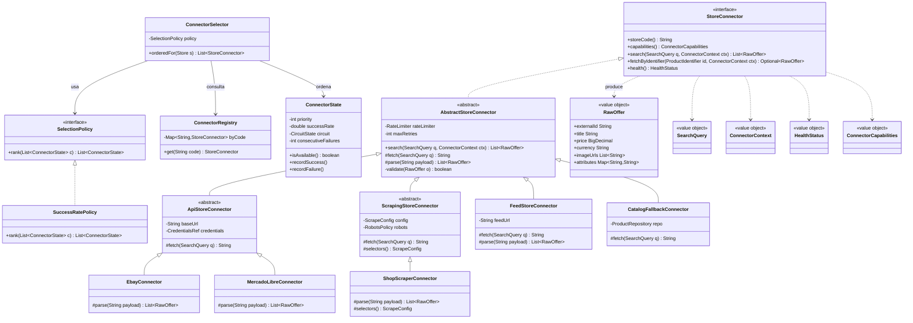
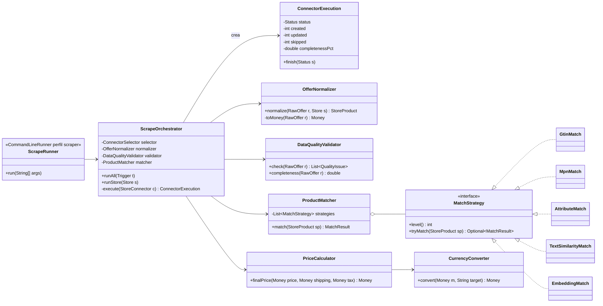
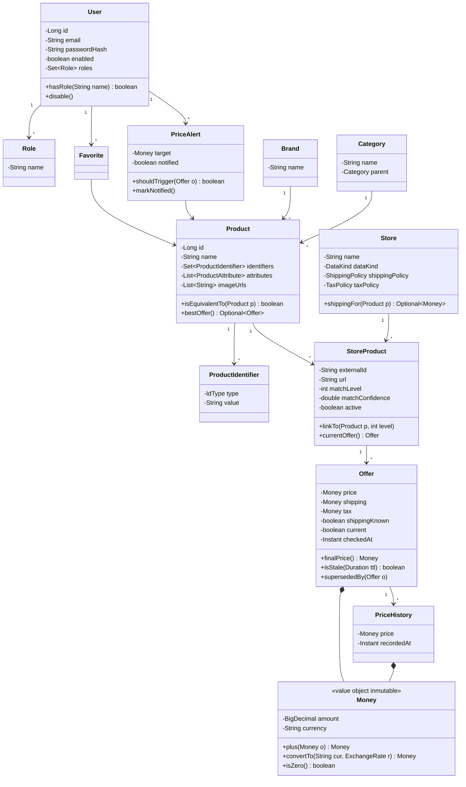
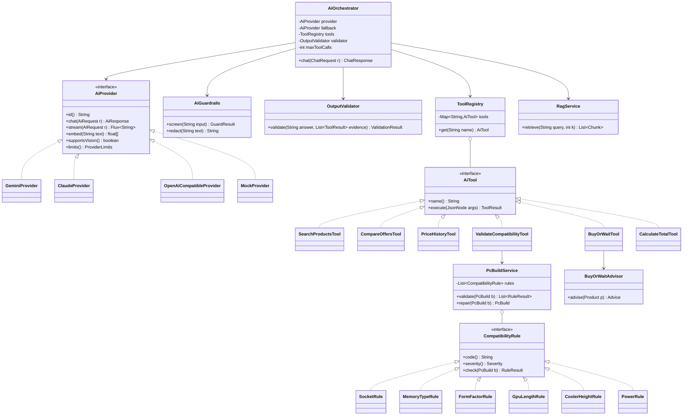

# SAMP — Diagramas de clases de dominio

Paquetes por módulo (v2.0): `web`, `service`, `domain`, `repository`, `dto`. Los diagramas muestran `domain` y los servicios clave. Interfaz = `<<interface>>`, clase abstracta = `<<abstract>>`.

## 1. Conectores (herencia, abstracción, polimorfismo)

## 2. Ingesta y normalización (perfil `scraper`)

Flujo: `selector.orderedFor(store)` → `connector.search()` → `validator.check()` (incidencias en `data_quality_issues`) → `normalizer.normalize()` → `matcher.match()` → `PriceCalculator` (Pf = Pp + Pe + Pi, envío desconocido nunca es cero) → persistir `offers` y `price_history`. Si el conector falla, `ConnectorState.recordFailure()` y se prueba el siguiente.

## 3. Dominio base (encapsulamiento)

## 4. IA y armador de PC

Las 10 herramientas de la v2.0 (`buscar_productos`, `obtener_producto`, `comparar_ofertas`, `historial_precios`, `prediccion_compra`, `listar_tiendas`, `buscar_componentes`, `validar_compatibilidad`, `calcular_total`, `consultar_ayuda`) implementan `AiTool`; el diagrama muestra seis. Las 10 reglas de compatibilidad implementan `CompatibilityRule`; el diagrama muestra seis (faltan conectores, almacenamiento, chipset/BIOS y equilibrio de rendimiento). Todas son de solo lectura.

## Trazabilidad con los 4 pilares POO

| Pilar | Dónde se demuestra |
|---|---|
| **Abstracción** | `StoreConnector`, `AiProvider`, `AiTool`, `CompatibilityRule`, `MatchStrategy`, `SelectionPolicy`: contratos que ocultan cómo se obtiene o valida cada dato. |
| **Encapsulamiento** | `Money` inmutable, `Offer.finalPrice()` y `Offer.isStale()`, `ConnectorState.recordFailure()`, `PriceAlert.markNotified()`: atributos privados y comportamiento en la clase. |
| **Herencia** | `AbstractStoreConnector` → `ApiStoreConnector` → `EbayConnector` / `MercadoLibreConnector`; `ScrapingStoreConnector` → `ShopScraperConnector`. |
| **Polimorfismo** | `ConnectorSelector` y `ScrapeOrchestrator` tratan cualquier `StoreConnector` igual; `AiOrchestrator` usa cualquier `AiProvider` (Gemini, Claude, Mock); `ProductMatcher` recorre `MatchStrategy`; `PcBuildService` aplica todas las `CompatibilityRule`. |

## Trazabilidad con los requisitos

| Requisito | Tablas | Clases |
|---|---|---|
| RF-06 recopilación automática | `store_connectors`, `connector_executions`, `raw_offers`, `offers`, `data_quality_issues` | `ScrapeRunner`, `ScrapeOrchestrator`, `StoreConnector` |
| RF-13 gestión de tiendas y conectores | `stores`, `store_connectors`, `connector_logs` | `ConnectorSelector`, `ConnectorState` |
| RF-19 asistente de IA | `ai_conversations`, `ai_messages`, `ai_tool_calls`, `ai_validation_results` | `AiOrchestrator`, `OutputValidator`, `AiTool` |
| RF-20 armador de PC | `component_specs`, `component_compat_rules`, `pc_builds`, `pc_build_items`, `pc_build_validations` | `PcBuildService`, `CompatibilityRule` |
| RF-21 búsqueda por imagen | `image_queries`, `product_embeddings` | `AiProvider.supportsVision`, `EmbeddingMatch` |
| RF-22 comprar o esperar | `price_history`, `benchmark_scores` | `BuyOrWaitAdvisor`, `BuyOrWaitTool` |
| RF-24 cuotas y costos | `ai_usage`, `ai_messages` | `AiGuardrails`, `ProviderLimits` |
| RF-25 configuraciones y alertas masivas | `pc_builds`, `price_alerts.pc_build_id` | `PriceAlert`, `PcBuildService` |
| RF-26 proveedor intercambiable | `system_settings` | `AiProvider`, `AiOrchestrator` |
