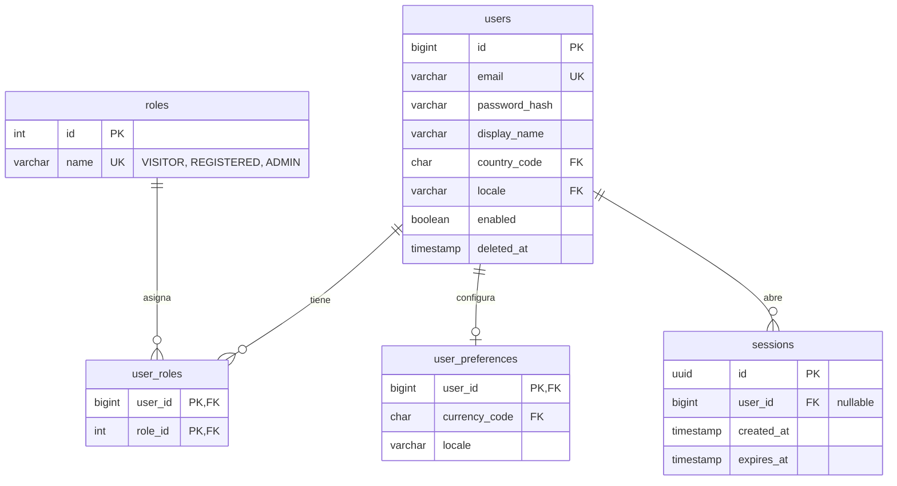
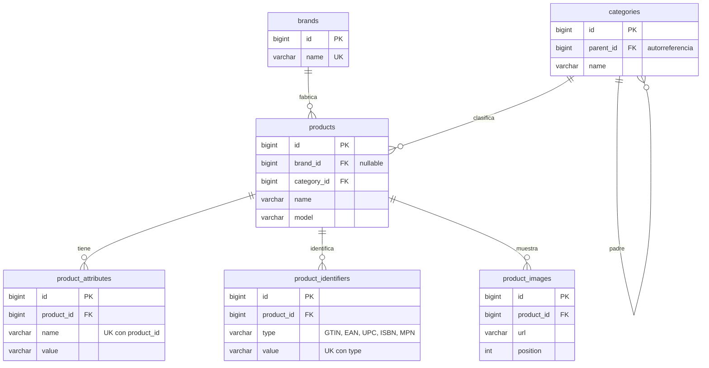
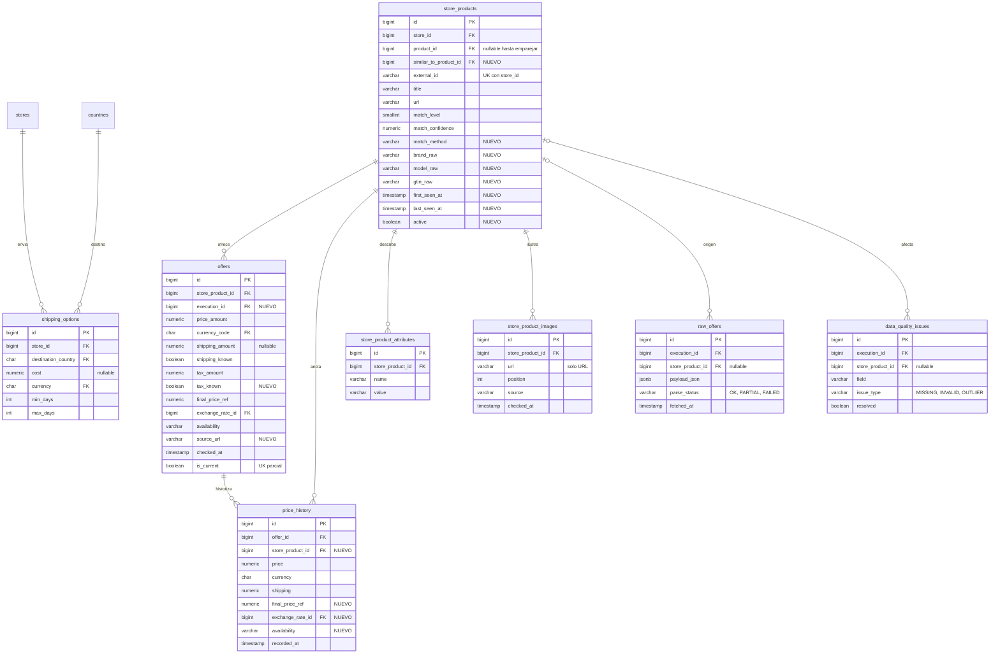
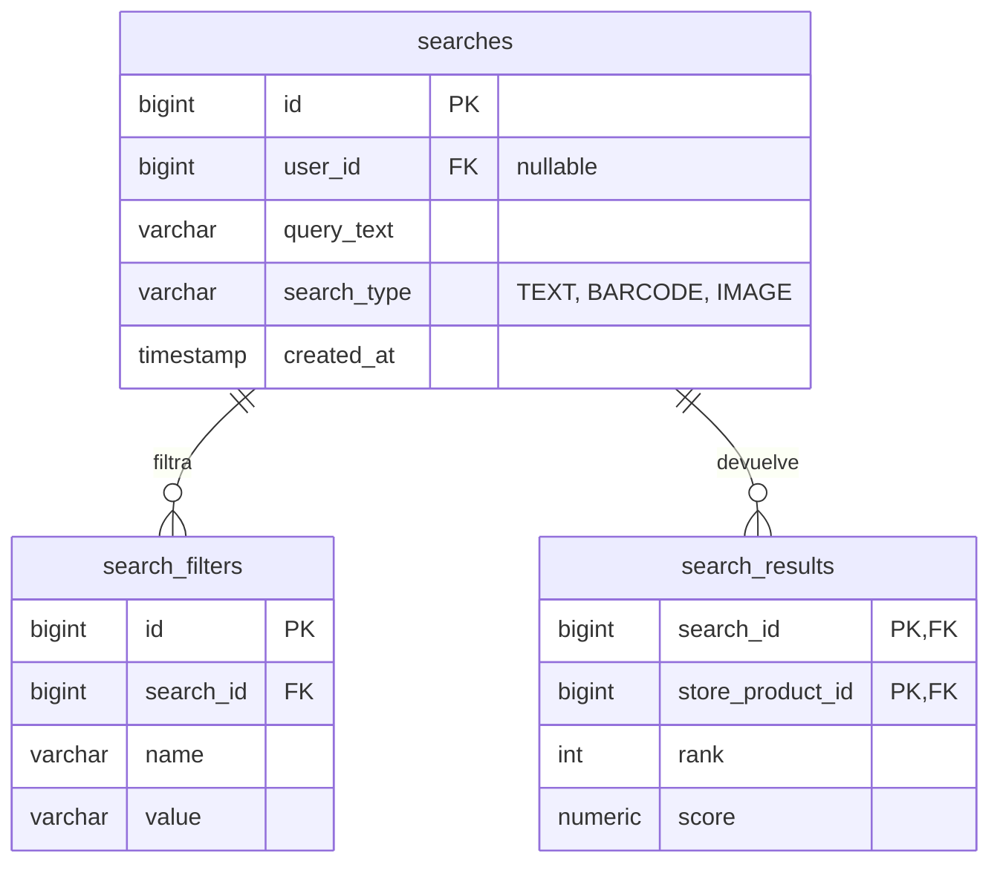
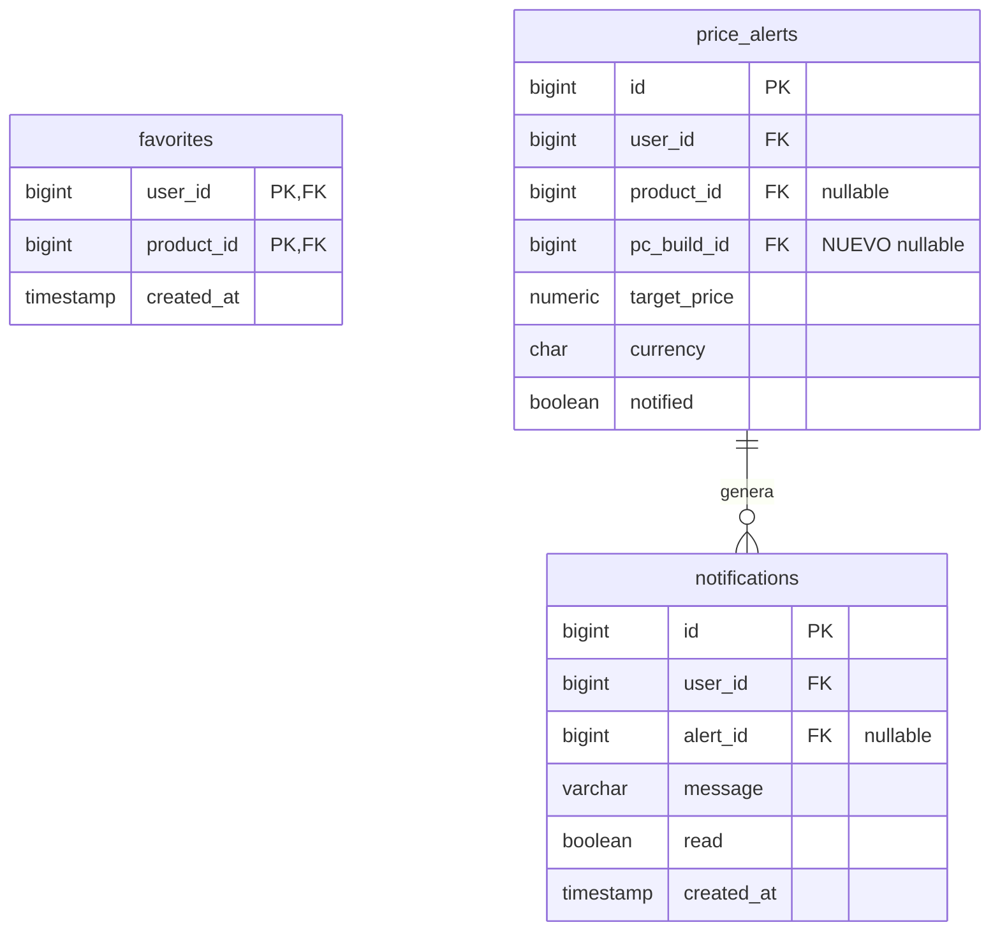
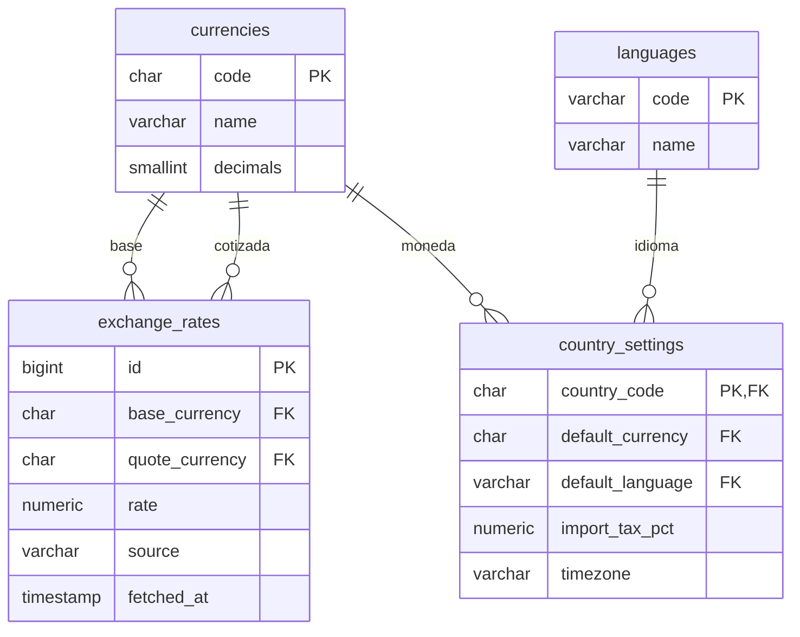
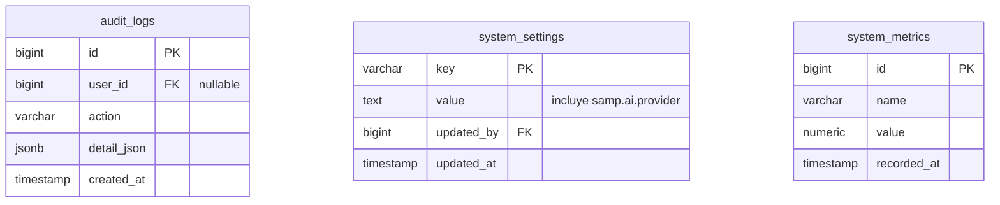
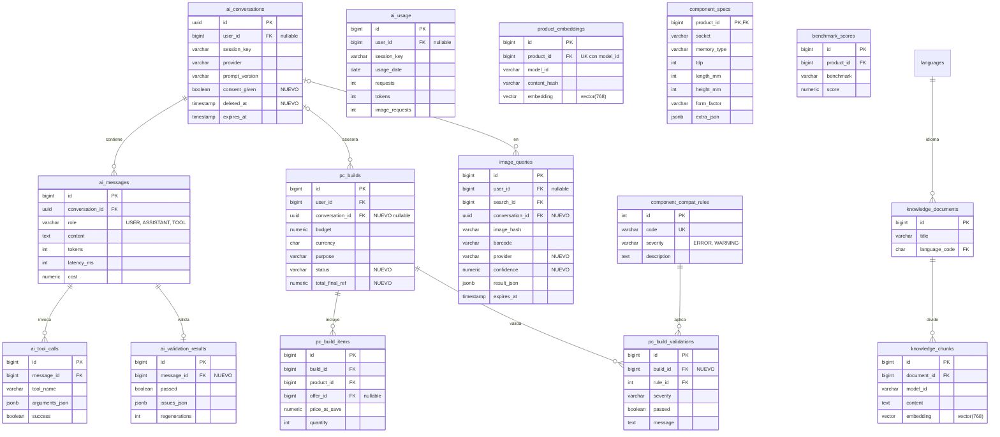

# SAMP — ER de base de datos (52 tablas)

Fuente: `docs/referencias/SAMP-UML-Base-de-Datos.svg` (46 tablas, v2.0) + 6 tablas nuevas y columnas añadidas (ver `docs/fuente-de-verdad.md`).
Motor: PostgreSQL (Supabase) con `pgvector`. Moneda: `numeric(14,2)`. Vectores: `vector(768)`.
Convención: `PK` clave primaria, `FK` clave foránea, `UK` única. **NUEVO** marca lo añadido sobre la v2.0.

## 0. Vista general (solo entidades y relaciones)

```mermaid
erDiagram
    users ||--o{ user_roles : tiene
    roles ||--o{ user_roles : asigna
    users ||--o| user_preferences : configura
    users ||--o{ sessions : abre
    countries ||--o{ users : reside
    languages ||--o{ users : habla
    currencies ||--o{ user_preferences : prefiere

    brands ||--o{ products : fabrica
    categories ||--o{ products : clasifica
    categories ||--o{ categories : padre
    products ||--o{ product_attributes : tiene
    products ||--o{ product_identifiers : identifica
    products ||--o{ product_images : muestra

    countries ||--o{ stores : ubica
    currencies ||--o{ stores : moneda_defecto
    currencies ||--o{ countries : moneda_defecto
    countries ||--o{ shipping_options : destino
    stores ||--o{ store_connectors : usa
    store_connectors ||--o{ connector_executions : ejecuta
    connector_executions ||--o{ connector_logs : registra
    searches |o--o{ connector_executions : dispara

    stores ||--o{ store_products : publica
    products |o--o{ store_products : equivale
    products |o--o{ store_products : similar_a
    store_products ||--o{ offers : ofrece
    connector_executions ||--o{ offers : origina
    currencies ||--o{ offers : moneda
    exchange_rates ||--o{ offers : tasa_usada
    offers ||--o{ price_history : historiza
    store_products ||--o{ price_history : ancla
    exchange_rates ||--o{ price_history : tasa_usada
    stores ||--o{ shipping_options : envia
    currencies ||--o{ shipping_options : moneda

    connector_executions ||--o{ raw_offers : captura
    store_products |o--o{ raw_offers : origen
    store_products ||--o{ store_product_attributes : describe
    store_products ||--o{ store_product_images : ilustra
    connector_executions ||--o{ data_quality_issues : detecta
    store_products |o--o{ data_quality_issues : afecta

    users |o--o{ searches : realiza
    searches ||--o{ search_filters : filtra
    searches ||--o{ search_results : devuelve
    store_products ||--o{ search_results : aparece

    users ||--o{ favorites : marca
    products ||--o{ favorites : es_favorito
    users ||--o{ price_alerts : crea
    products ||--o{ price_alerts : vigila
    pc_builds |o--o{ price_alerts : vigila_build
    users ||--o{ notifications : recibe
    price_alerts |o--o{ notifications : genera

    currencies ||--o{ exchange_rates : base
    currencies ||--o{ exchange_rates : cotizada
    countries ||--o| country_settings : configura
    languages ||--o{ country_settings : idioma
    currencies ||--o{ country_settings : moneda

    users |o--o{ audit_logs : actua
    users ||--o{ system_settings : actualiza

    users |o--o{ ai_conversations : conversa
    ai_conversations ||--o{ ai_messages : contiene
    ai_messages ||--o{ ai_tool_calls : invoca
    ai_messages ||--o| ai_validation_results : valida
    users |o--o{ ai_usage : consume
    languages ||--o{ knowledge_documents : idioma
    knowledge_documents ||--o{ knowledge_chunks : divide
    products ||--o{ product_embeddings : vectoriza
    users |o--o{ image_queries : consulta
    searches |o--o{ image_queries : origina
    ai_conversations |o--o{ image_queries : en
    products ||--o| component_specs : especifica
    products ||--o{ benchmark_scores : mide
    users ||--o{ pc_builds : arma
    ai_conversations |o--o{ pc_builds : asesora
    pc_builds ||--o{ pc_build_items : incluye
    products ||--o{ pc_build_items : pieza
    offers |o--o{ pc_build_items : precio_guardado
    pc_builds ||--o{ pc_build_validations : valida
    component_compat_rules ||--o{ pc_build_validations : aplica

    system_metrics
```

## A. Usuarios y seguridad (5)

## B. Catálogo (6)

## C. Tiendas y conectores (5) — con selección automática y respaldo

```mermaid
erDiagram
    countries {
        char code PK "ISO 3166"
        varchar name
        char default_currency FK
    }
    stores {
        bigint id PK
        char country_code FK
        varchar name
        varchar base_url
        char default_currency FK
        numeric reliability_score
        boolean active
        varchar data_kind "NUEVO REAL o DEMO"
        varchar shipping_policy_type "NUEVO"
        numeric flat_shipping_amount "NUEVO"
        boolean tax_included "NUEVO"
        numeric tax_rate "NUEVO"
    }
    store_connectors {
        bigint id PK
        bigint store_id FK
        varchar connector_type "clase concreta"
        smallint phase
        boolean enabled
        int rate_limit_per_min
        varchar credentials_ref
        varchar kind "NUEVO API, SCRAPER, FEED"
        int priority "NUEVO menor = primero"
        numeric success_rate "NUEVO 0 a 1"
        int consecutive_failures "NUEVO"
        timestamp last_success_at "NUEVO"
        varchar circuit_state "NUEVO CLOSED, OPEN, HALF_OPEN"
        jsonb config_json "NUEVO selectores o endpoints"
        varchar evidence_url "NUEVO permiso de uso"
        timestamp robots_checked_at "NUEVO"
        int ttl_minutes "NUEVO frescura"
        int daily_call_budget "NUEVO"
    }
    connector_executions {
        bigint id PK
        bigint connector_id FK
        bigint search_id FK "NUEVO nullable"
        timestamp started_at
        timestamp finished_at
        varchar status
        int items_fetched
        int error_count
        varchar trigger "NUEVO SCHEDULED, MANUAL, LIVE"
        varchar runner "NUEVO ACTIONS, RENDER, LOCAL"
        int items_created "NUEVO"
        int items_updated "NUEVO"
        int items_skipped "NUEVO"
        numeric completeness_pct "NUEVO"
        text error_message "NUEVO"
    }
    connector_logs {
        bigint id PK
        bigint execution_id FK
        varchar level
        text message
        timestamp logged_at
    }
    countries ||--o{ stores : ubica
    currencies ||--o{ countries : moneda_defecto
    stores ||--o{ store_connectors : usa
    store_connectors ||--o{ connector_executions : ejecuta
    connector_executions ||--o{ connector_logs : registra
```

## D. Ofertas, precios e ingesta (4 + 4 nuevas)

## E. Búsquedas (3)

## F. Seguimiento (3)

## G. Internacionalización (4)

## H. Administración (3)

## I. IA y armador de PC (13 + 2 nuevas)

## Notas de diseño
- **`offers` es append-only con `is_current`**: una fila vigente por `store_product` (índice único parcial); las anteriores quedan como historial. `price_history` guarda además un registro compacto con tasa y disponibilidad.
- **Imágenes**: solo URLs (`product_images` para el producto canónico, `store_product_images` por publicación).
- **Selección de conector**: el orquestador ordena `store_connectors` por `priority` y `success_rate`, salta los de `circuit_state = OPEN` y pasa al siguiente si falla.
- **Frescura**: una oferta con `checked_at` anterior a `ttl_minutes` del conector se trata como desactualizada.
- **Vectores**: `vector(768)` con un único modelo de embeddings por índice; cambiar de modelo exige reindexar (`content_hash`).
